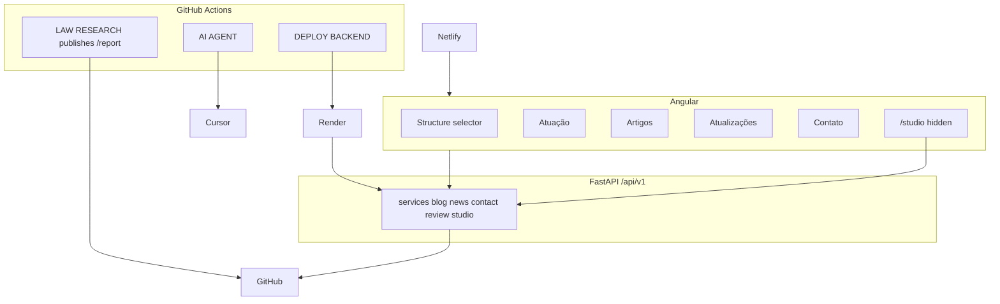

# Architecture

News and articles enter a review queue before they are treated as published copy. The law research action publishes the tax and corporate bulletin to `/report`. The `solve` label is only for code changes.
